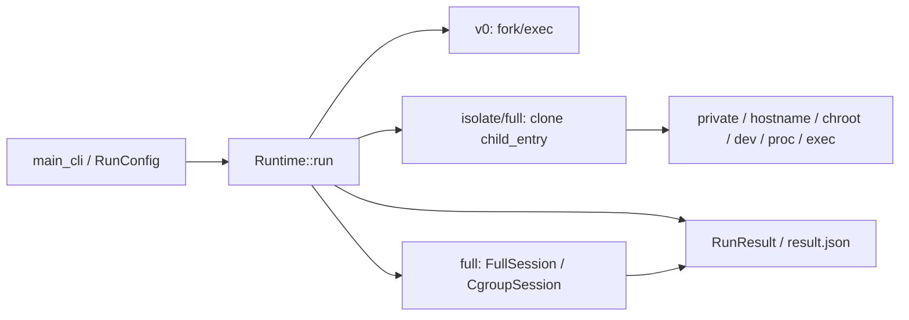
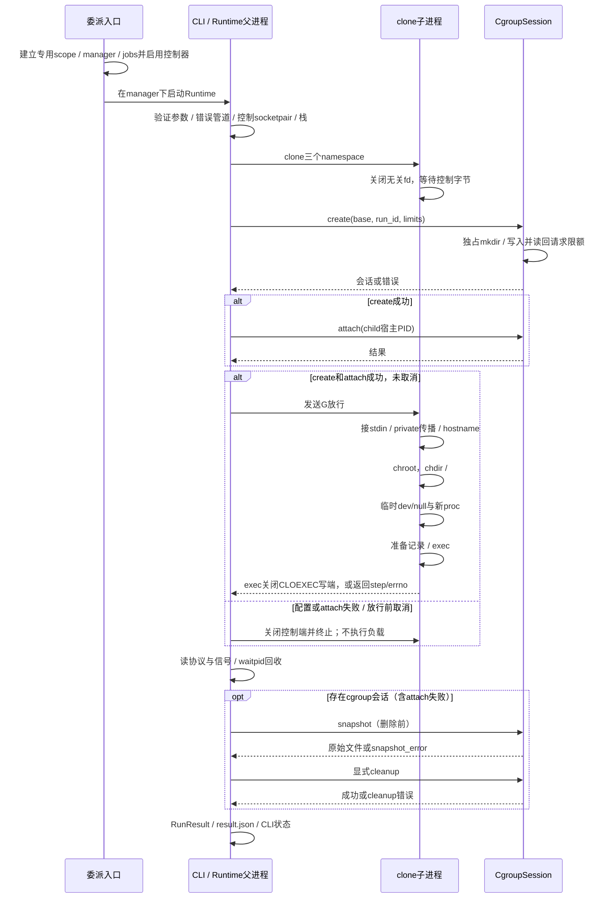

# V1 实际架构与父子启动顺序

材料基线main：`25cf83acb7bfe080e12c1eb19d4318721f7fb109`；两机实际被测实现/脚本：`97800f0244b807466e7c516021f3c40b882abf45`。两者运行源码和测试相同，后续仅证据变化。执行顺序按新版 V1_ACCELERATED_WORKFLOW.md，接口沿用 contracts.md。

## 模块与职责

CLI解析参数和数值，Runtime验证语义、持有run_id/宿主PID、管道、会话和clone栈。A负责这些编排与隔离；B实现CgroupSession、委派入口、负载和统一验收。外部systemd入口准备可用委派，不是cgroup模块替用户修改系统根层级。

v0用fork，执行宿主程序；isolate/full用clone，1MiB独立回调栈，标志为CLONE_NEWPID|CLONE_NEWUTS|CLONE_NEWNS|SIGCHLD，不用CLONE_VM/FILES/THREAD。full另加真实cgroup限额，任何失败不退回isolate/v0。

## full 时序

isolate也等待G，但不创建cgroup；v0没有这条隔离准备链。控制通道是socketpair的单向使用，发送使用MSG_NOSIGNAL；它与返回定长错误记录的CLOEXEC pipe是两个独立通道。

## 为什么按此排序

1. **验证在创建前**：缺参数、危险/不完整Rootfs和非法限额在执行负载前拒绝；Rootfs要求专用标记和真实dev/proc目录。
2. **clone后先等待**：已有宿主PID可供attach，但负载尚未运行；若先exec再attach，会出现不限额的执行窗口。子端只接受明确G，EOF/错误不运行。
3. **先private再挂载**：把传播设为MS_REC|MS_PRIVATE，防止随后挂载影响宿主。UTS变化只发生在子namespace。
4. **chroot后chdir /**：消除旧cwd仍指向宿主目录的情况；关闭无关宿主fd，避免把宿主目录句柄交给负载。并不据此宣称防逃逸。
5. **新PID namespace内挂proc**：让/proc的进程视图对应新PID namespace；不是只改了显示出来的PID数字。
6. **私有/dev/null在exec前**：stdin虽在chroot前接好，BusyBox后台任务仍会自行打开/dev/null；在子挂载空间用tmpfs提供字符设备1:3，不绑定宿主/dev，不向Rootfs资产遗留节点。
7. **wait后采样，删除前snapshot**：先终止负载并回收，再保存本轮memory.events/cpu.stat和限额原文；删除后无法补采OOM证据。随后显式cleanup，失败可报告，析构仅兜底。

## PID、fd、栈与会话的所有权

| 资源 | 持有者 / 生命周期 |
|---|---|
| clone栈与回调参数 | 父进程保持到子进程回收；不与子进程共享VM |
| 控制端与错误管道 | 父子各留所需端；子进程exec前关闭无用fd，错误写端CLOEXEC |
| CgroupSession | 父进程唯一持有，可移动构造、不可复制/移动赋值；create失败回滚，cleanup失败保留所有权 |
| namespace挂载 | 子Mount namespace内；最后相关进程退出释放，Rootfs文件资产继续保留 |
| host_pid / run_id / JSON | 父生成和汇总；宿主PID与容器PID1指向同一个任务，不是两个独立负载 |

同一任务从宿主看是实际host_pid，从子PID namespace看是1；PID/UTS/Mount namespace标识与宿主不同，已有运行期对照见A-1证据。namespace PID1可能忽略普通终止信号，运行器收到SIGINT/SIGTERM时通过signalfd进入正常控制流，对自己的init使用SIGKILL有界终止后wait，后代随PID namespace生命周期结束。这里没有init包装进程或通用守护进程管理。

## 错误与真实覆盖

错误记录含step、原始errno和消息。CLOEXEC EOF只表示写端关闭，提前死亡也可造成EOF；父结合准备记录与wait状态，不单靠EOF宣称exec成功。create/attach错误优先保留，关闭控制端后的子错误不覆盖它。snapshot_error、cleanup.errors、evidence_errors独立；负载成功但收尾失败为cleanup_error/125，非零负载/信号保留原原因并附收尾错误。

两机同候选12项覆盖退出分类、隔离smoke、create失败、测试构建触发真实内核attach拒绝、CPU节流、OOM和两种中断/后代回收。测试专用minic_attach_rejection只用于失败路径，生产minic不含该宏；测试替身的9项控制逻辑结果也单独标为模拟，不替代内核验收。

真实问题闭环：Rootfs缺/dev/null导致后台任务未启动，先改重定向仍失败，补私有null设备后隔离/中断复验通过；B首次缺Rootfs与runner报告缺陷也保留。见 [A失败记录](evidence/A/isolation/first-native-run.md)、[B复验与旧失败](evidence/B/B3/report.md)。

不承诺生产安全、任意不可信/守护负载、运行器SIGKILL或掉电后恢复；不支持网络、Seccomp、TTY、User namespace、daemon或pivot_root。LSan未验证通过。当前材料未发现需以文字掩盖的新增代码阻断；实际演示彩排和B剩余人工学习记录仍按本人反馈补齐。
